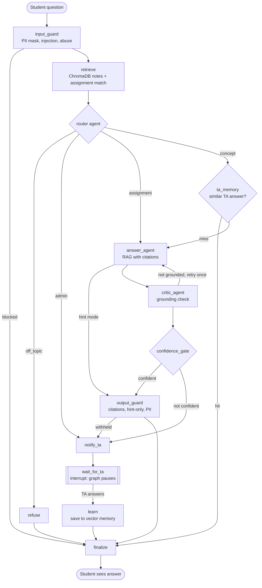

# DoubtLoop: architecture

## Workflow (LangGraph)

The Faculty view renders the same graph live from the compiled LangGraph object.

## Components

| File | Role |
|---|---|
| `doubtloop/graph.py` | LangGraph state, nodes, conditional edges, SQLite checkpointer, `interrupt()` |
| `doubtloop/agents.py` | Router, Answer, Critic and Insight agents (LLM + offline fallback) |
| `doubtloop/guardrails.py` | Input/output guardrails (regex + rules) |
| `doubtloop/knowledge.py` | ChromaDB: `course_notes`, `ta_answers`, `assignments` collections; chunking |
| `doubtloop/store.py` | SQLite table of doubts, statuses, traces, guardrail events |
| `doubtloop/service.py` | `ask()`, `ta_reply()` (resumes the graph), auto-resolve similar doubts, seeding |
| `app.py` | Streamlit UI: Student, TA, Faculty views |
| `eval/` | Test set, evaluation metrics, learning-curve experiment |

## Memory design

| Memory type | Where | Example |
|---|---|---|
| Semantic (course knowledge) | ChromaDB `course_notes` | chunk of Unit 2 about chunk overlap |
| Semantic (learned from humans) | ChromaDB `ta_answers` | the TA's answer about MCP |
| Episodic | SQLite `doubts` | "Student A asked about MCP on 14 Oct, escalated" |
| Workflow state | SQLite checkpoints | a paused graph waiting for a TA |

## Confidence score

`confidence = 0.4 × retrieval similarity (normalised) + 0.6 × critic score`.
The doubt is escalated if confidence < 0.55, the critic says the draft isn't grounded after one retry, the answer agent says `NOT_IN_NOTES`, or the citation guardrail withholds the answer.

## Syllabus mapping

| Unit | Concept | Where in DoubtLoop |
|---|---|---|
| 1 | Agent vs chatbot | decides, routes, escalates and learns instead of only replying |
| 1 | Function calling / tools | retrieval, TA-memory search and escalation are tools the graph calls |
| 1 | Memory (episodic, semantic) | see memory table above |
| 1 | Planning / decomposition | router chooses the path per doubt |
| 2 | LangChain components | chat model wrappers, messages (langchain-core, langchain-groq) |
| 2 | ChromaDB, RAG pipeline, chunking | `knowledge.py`: heading-aware chunking with overlap, top-k retrieval |
| 2 | Embeddings, cosine similarity | MiniLM embeddings; cosine used for RAG, TA-memory reuse, assignment match |
| 2 | Persistent memory | Chroma + SQLite on disk, survive restarts |
| 3 | Orchestrator–worker | LangGraph orchestrates router/answer/critic/insight workers |
| 3 | Reflection / self-critique | critic agent + one rewrite loop |
| 3 | Human-in-the-loop | `interrupt()` + resume, TA queue, feedback stored into memory |
| 4 | Evaluation | `eval/run_eval.py`: task completion, escalation precision/recall, guardrail accuracy, trajectories |
| 4 | Guardrails | 7 guardrails, logged and shown in the UI |
| 4 | Observability | per-node trace with timings in every record; optional LangSmith |
| 4 | Failure modes | hallucination → critic + citations; loops → retry limit; injection → input guard |
| 4 | Ethics / privacy | PII masking, model card (`docs/MODEL_CARD.md`) |
| 5 | Deployment | Streamlit Community Cloud (public link) |

Not covered by design: AutoGen/CrewAI (LangGraph chosen for its built-in pause/resume), FastAPI + React (Streamlit instead), Docker (optional).
